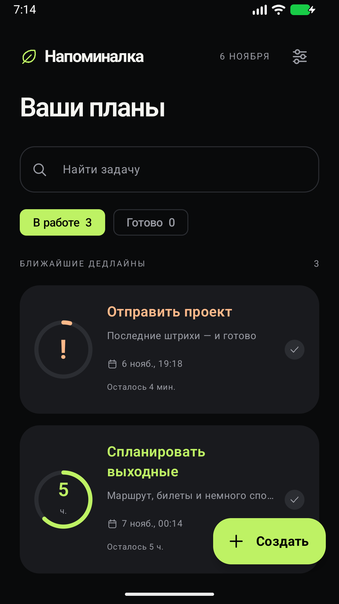
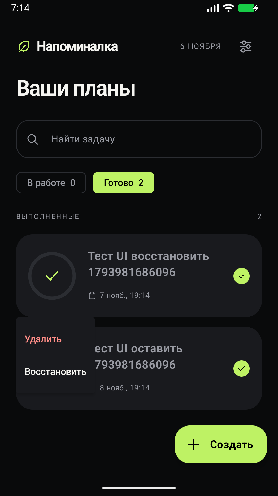

# Напоминалка

Локальный планер для Android 8.0 и новее. Задачи и настройки хранятся на устройстве. Аккаунт и интернет для работы не нужны.

**[Скачать APK v1.1.1](https://github.com/zzz1ne/napominalka/releases/download/v1.1.1/napominalka-1.1.1.apk)** · [Страница релиза](https://github.com/zzz1ne/napominalka/releases/tag/v1.1.1)

Откройте APK на телефоне и подтвердите установку. Если предыдущая сборка уже установлена, обновите её поверх, чтобы сохранить задачи. APK подписан отладочным ключом.

## Возможности

- Задачи с названием, описанием, дедлайном и произвольным цветом.
- Круговой отсчёт с «!» при остатке 5% времени и меньше.
- Системные напоминания с выбором времени. По умолчанию предлагается напомнить за сутки.
- Поиск, список выполненных задач, светлая и тёмная темы и выбор цвета интерфейса.
- Долгое нажатие в разделе «Готово» открывает меню «Удалить» и «Восстановить».

| Список задач | Действия в разделе «Готово» |
| --- | --- |
|  |  |

